# finops-agent：带证据找云上浪费的 AWS FinOps agent

一个带证据找云上浪费的 AWS FinOps agent，同时也是一份用 spec、评估和护栏构建 LLM agent 的完整样例。

分两部分。**第一部分**是 FinOps：领域模型，以及我做成本优化的方法。**第二部分**是 agent：它怎么设计，背后的原则是什么。FinOps 是载体，第二部分才是重点。

```bash
pip install -r requirements.txt
make eval                    # 假 AWS + 假 Prometheus → 跑 agent → 对照标准答案打分
open runs/local/report.html
```

不需要 AWS 账号。合成账号和两个测试服务器见 [`testenv/README.md`](testenv/README.md)。

**入口**

| 想知道什么 | 去哪 |
|---|---|
| 这个项目证明了什么（面试叙事，每条能力带证据和边界） | [`docs/NARRATIVE.md`](docs/NARRATIVE.md) |
| 完成标准逐条核对 | [`docs/MATURITY.md`](docs/MATURITY.md) |
| 怎么用 agent 把它做出来 | [`docs/BUILD_PROCESS.md`](docs/BUILD_PROCESS.md) |
| 模块、数据流、产物契约 | [`docs/ARCHITECTURE.md`](docs/ARCHITECTURE.md) |
| 怎么参与改动 | [`CONTRIBUTING.md`](CONTRIBUTING.md) |
| 图、全部改动、指标一页看完 | [`reports/index.html`](reports/index.html) |
| 测试账号的标准答案和陷阱（五段式） | [`reports/testenv-catalog.html`](reports/testenv-catalog.html) |
| 省下的钱是不是真的 | [`docs/SAVINGS_VERIFICATION.md`](docs/SAVINGS_VERIFICATION.md) |
| 判断层怎么评估，哪些数字能信 | [`eval/EXPERIMENTS.md`](eval/EXPERIMENTS.md) |
| 清理之后怎么不复发 | [`docs/FINOPS_SLO.md`](docs/FINOPS_SLO.md) |

---

## 我怎么思考这个 agent

动手写代码之前我问了自己这些问题，回答决定了它现在的样子。每条都能追到 [`docs/REQUIREMENTS.md`](docs/REQUIREMENTS.md) 里编号的需求。

| 问题 | 我的回答 |
|---|---|
| **为什么做它？** | 练习并展示 agent 工程能力：让一个 agent 在真实系统上可控、可度量、可改进。成本是好载体：每家公司都有这个问题，数据是结构化的，答错有实际代价。（R1、R15） |
| **agent 工程和 agent 开发有什么区别？** | 开发是让模型把事做成。工程是决定它能碰什么、被告知什么、输出怎么检查、怎样变好而不倒退。Context 决定上限，harness 决定下限。（R1、R6） |
| **模型弱在哪？** | 会编数字，会听从本该只读的文本，会偏离你设定的路径。所以：数字由代码算，资源元数据按不可信输入处理（测试账号里埋了一条注入），方法论固定路径。（R6） |
| **判断还是验证？** | agent 做验证，不下断言。每个结论带证据，每个金额带口径，不变量拒绝不可能成立的答案，不管答案是谁给的。（R7） |
| **"更好"指什么？** | 对照标准答案的数字：召回率、按金额加权的召回率、精确率、踩陷阱次数。基线只升不降，CI 强制。（R7） |
| **为什么测试数据要难？** | 只会找闲置卷的 agent 是个脚本。真实的浪费藏在数据源的交叉处（成本 × 资产 × 利用率 × 有效工作），真实的陷阱长得像浪费。测试账号就是这样造的。（R2、R3） |
| **从哪开始？** | 从目标开始。先定成本决策需要的 SLI，再去找指标。缺失的指标本身就是一条发现。（R17、R19） |
| **清理之后呢？** | 会腐烂。成本健康要有 SLO、浪费预算、告警规则和巡检节奏，每次运行都和上一次比对，抓复发。（c0007） |
| **它能做到哪一步？** | 只读，两层强制（hook、IAM）。修复只出计划；最难撤回的承诺折扣永远由人决定。（R4、R16） |
| **过程即交付** | 每个改动都是一份 spec、按阶段的 commit、带证据的验收、一份 HTML 报告和原始笔记。代码看得见，推理过程也看得见。（R8、R9） |
| **什么保持私有** | 雇主数据一律不进。只用合成数据和个人只读账号；每次提交都跑泄漏扫描。（REQUIREMENTS §4 约束） |

---

## 第一部分 · FinOps

### 1.1 领域模型

每一行成本都是 **单价 × 用量 × 时长**，挂在（或没挂在）某个**资源**上，资源归属（或不归属）某个**服务**和**团队**。优化就是动这三个因子中的一个；归因决定谁来动手。

| 概念 | 是什么 | agent 从哪读 |
|---|---|---|
| 花费 | 按服务、用量类型、资源、tag 拆分的账单行；unblended 与 amortized 两种口径 | Cost Explorer |
| 资源 | 实例、卷、快照、镜像、IP、NAT 网关、启动模板、ASG | EC2 / Auto Scaling API |
| 归属 | `owner` / `service` / `env` tag，以及可能和它们矛盾的事实（启动模板、ASG、指标标签） | tag + 资产 + 指标 |
| 计价模式 | 按需、Savings Plan / RI（含利用率）、牌价 | Cost Explorer、Savings Plans API |
| 用量信号 | 利用率（CPU、网络），以及**有效工作**（成功的 job、处理的请求） | Prometheus |
| 约束 | 一份容量在保护的 SLO（延迟余量、DR 温备） | 指标 + tag |
| 共享成本 | 不挂资源的行：NAT 处理费、跨 AZ 流量、承诺费用 | Cost Explorer 用量类型 |

浪费有几种形态，各自需要不同的证据：

| 形态 | 例子 | 最少需要的证据 |
|---|---|---|
| 闲置 | 未挂载的卷、未关联的 IP | 资产状态 |
| 搁浅 | 停机数月的实例上的卷；已删卷的快照 | 资产关联 + 成本 |
| 忙但无用 | CPU 60% 但 job 全部失败的 fleet | 成本 + 利用率 + **工作结果**指标 |
| 路径成本 | 被重试放大的 NAT 字节；跨 AZ 频繁通信的服务 | 用量类型成本 + 拓扑 + 流量指标 |
| 搁浅的承诺 | fleet 迁走后覆盖不到的 Savings Plan | 利用率历史 + 资产 |
| 归因错误 | tag 写一个团队，实际跑另一个团队的任务 | tag vs 启动模板 vs 指标标签 |
| **不是浪费** | 平均低、峰值真实的潮汐 fleet；DR 温备 | 峰值分布、SLO、意图 tag |

### 1.2 我怎么做成本优化

完整方法：[`docs/METHOD.md`](docs/METHOD.md)。



**两个层级。** 运营级优化动单价（删、降配、换存储类、买承诺），天花板是折扣率。架构级优化动用量或时长（缩到零、批任务改成临时任务、改数据路径），天花板是数量级。每份账单里两类都有，架构级的藏得更深。

**七步，按顺序。** M0 看数据之前先定成本目标和它的 SLI → M1 归因 → M2 二八排序与意外项 → M3 清理 → M4 降配与调度 → M5 承诺折扣 → M6 架构级。先删再降最后买：先买承诺等于给浪费上锁。

**硬规则。**

- 余量对 SLO 负责。"70%"只是一个数字，砍之前先问它在保护哪条 SLO。
- 潮汐不是浪费。峰值能降下来是弹性；一直降不下来的容量才是浪费。
- 承诺会改写节省。停掉被一个用不满的 Savings Plan 覆盖的用量，省不到钱。
- 一个根因可能抬高好几行账单。先找到它，再分别算钱。
- 节省不会超过花费。超过了，说明归因错了。
- 每个金额标明口径：已对账、牌价估算或推断。
- 清理会腐烂。成本健康和可靠性一样，需要 SLO、浪费预算、告警和巡检节奏。见 [`docs/FINOPS_SLO.md`](docs/FINOPS_SLO.md)。
- 消失不等于解决。资源还在、成本没变的 finding 是漏检（`not_redetected`），只有资源或成本变了才算 `resolved`。
- 省钱要核实。两张发票相减会得出「清理没效果」，要用对照组和账单分解算真实节省，见 [`docs/SAVINGS_VERIFICATION.md`](docs/SAVINGS_VERIFICATION.md)。



### 1.3 在测试账号上的当前结果

三层结果分开报，因为它们证明的东西不同。数字来自 [`eval/EXPERIMENTS.md`](eval/EXPERIMENTS.md) §7.3 和 `python3 -m eval.heldout`（回放，约 10 秒）。

| 层 | 世界 | recall | 按金额加权 recall | 深层 recall | 踩陷阱 | 它证明什么 |
|---|---|---|---|---|---|---|
| 样本内 | 基础世界（prompt 对着它调过） | 1.0 | 1.0 | 1.0 | 0 | 判断层在这个账号上把跨源判断做到顶，是上界，不是泛化指标 |
| 样本外（已污染，见 EXPERIMENTS §6） | next_month、month_after | 1.0 / 1.0 | 1.0 / 1.0 | 1.0 / 1.0 | 0 | 只说明 c0023 的修复有效；第一次评估是 0.9 / 0.9091，之后对着失败修过，这两个世界不再是样本外 |
| 预注册的全新世界 | fresh_world（货运 SaaS，冻结后只评估一次） | 0.75 | 0.568 | 0.667 | 1 | 唯一没被污染的泛化数字：换一个世界会掉，漏检在确定性检测与取证层，判断层 8 个判断全部被接受 |

作为对照，只开确定性层、不开判断层时，基础世界 recall 0.5833，金额加权 0.1888（[`eval/EXPERIMENTS.md`](eval/EXPERIMENTS.md) §0）。

基础世界上其余指标：精确率 1.0，金额落在区间内 0.9167，方法步骤一致 1.0，违反不变量 0。预注册世界上精确率 1.0，金额落在区间内 0.5385（其中有评分粒度的成分，见 §7.5 勘误）。三个已知漏检（持平的 NAT 异常、跨 AZ 取证、非模板路径的错标）和一个陷阱违规（保留 tag 的卷）是后续工作，见 [`docs/NARRATIVE.md`](docs/NARRATIVE.md) 的诚实成绩单。

---

## 第二部分 · agent

### 2.1 设计





| 层 | 职责 | 为什么单独一层 |
|---|---|---|
| 采集 | 拉资产、成本、指标；每次调用留痕 | 唯一接触外部世界的层，从构造上就是只读 |
| 快照 | 冻结输入 | 运行可以精确重放；答错了能复现 |
| 检测器 | 算术和关联，每个对应一个方法步骤 | 每个数字可复算；这一层没有模型 |
| 线索 | 需要跨源判断的信号，附待回答的问题 | 模型拿到的是问题和证据，不是原始数据堆 |
| 判断 | 每条线索一次独立的 LLM 调用：代码取证并算出候选金额，模型只选；录制回放（cassette），CI 不需要 API key | LLM 真正产生价值的地方，也是被评估的地方；模型不做算术 |
| 落地与脱敏 | 模型输出的数字必须取自证据；叙述里未落地的数字按从句脱敏并留痕，结构化字段不落地才整条拒绝 | 校验器不能成为攻击面：「fail closed」会让攻击者靠数字诱饵压掉真 finding |
| 不变量 | 节省 ≤ 花费、必须有口径、必须有证据 | 不管答案是谁给的，错的都会被拦下 |
| 处置计划 | 每个有节省的发现一份 dry-run 计划（撤回成本、回滚、前置检查），无 `--approve` 不执行；承诺折扣只给建议 | 高撤回成本的动作由人决定 |
| 五段式卡片 | 每条发现与每条标准答案读成：现状、期望、差异、处置、预防 | 从「是什么」一路读到「怎么防复发」，数字由代码算 |
| 可见性链 | 目标优先：需求（可由 LLM 推导，只写词不写名）→ 计划（按语义发现指标名）→ 搜索 → 缺口 | 缺失的指标也是发现 |
| 评估 | 对照标准答案打分；陷阱；回归基线；样本内、样本外、预注册新世界分开报 | 「更好」是一个数字，CI 强制；样本外是流程属性，冻结在前才算数 |
| SLO 与腐烂 | 每次运行算 SLI、浪费预算、跨运行的新增 / 持续 / 已解决 / 复发 / 未再检出（`not_redetected`）；导出 Prometheus 指标和告警规则 | 清理会腐烂，下一次运行必须察觉；漏检不能伪装成整改 |
| 省钱核实 | 用前后两期 Cost Explorer 算反事实基线、对照组和账单分解，核对 resolved 的发现是否真的省钱 | 预测不等于兑现：场景链预测 $744.21，实现 $140.60（18.9%） |

### 2.2 设计原则

每条原则都是一条项目公理，并且有具体的落地点（[`rules/axioms/`](rules/axioms/INDEX.md)）。

| 原则 | 靠什么落实 |
|---|---|
| 可验证先于正确 | 每条发现带证据；对照标准答案评估 |
| 隔离、处理、验证 | 只读采集、冻结快照、只出 dry-run 计划 |
| 数据优于观点 | 检测器负责计算；模型从不做算术 |
| 误差会级联放大 | `节省 ≤ 花费` 不变量；金额带口径 |
| agent 是不可靠组件，SRE 是它的外壳 | hook、服务端拒绝写、IAM、评估闸门 |
| 责任不能委派 | 写操作需要人；报告区分事实与推断 |
| 以终为始 | 查任何指标之前先走可见性链第 ① 环 |
| 上下文隔离 | 每条线索只带判断它所需的证据 |
| 文档即记忆 | 规则层、OpenSpec 改动、每个改动一份笔记 |

### 2.3 怎么构建



| 实践 | 在哪 |
|---|---|
| 多 agent 并行构建：完成标准、独立 worktree、owned_paths、主 agent 只合并并重验、变更走 escrow | [`docs/BUILD_PROCESS.md`](docs/BUILD_PROCESS.md)、[`docs/MATURITY.md`](docs/MATURITY.md) |
| spec 驱动的改动，按阶段提交（proposal → spec → impl → docs → acceptance） | [`openspec/changes/`](openspec/changes/)、`git log` |
| 每个改动的验收：证据、HTML 报告、原始笔记；CI 跑 check → test → eval | [`reports/`](reports/)、[`notes/blog/`](notes/blog/)、[`.github/workflows/ci.yml`](.github/workflows/ci.yml) |
| 判断层与 LLM 评估：record/replay、对抗变体、预注册样本外 | [`finops_agent/judge/`](finops_agent/judge/)、[`eval/EXPERIMENTS.md`](eval/EXPERIMENTS.md) |
| 两层护栏 | [`hooks/`](hooks/)、[`docs/aws_account_hardening.md`](docs/aws_account_hardening.md) |
| 从私有工作区蒸馏出的规则层 | [`docs/DISTILLATION.md`](docs/DISTILLATION.md) |
| harness 实践覆盖面：做了的和没做的 | [`docs/REQUIREMENTS.md`](docs/REQUIREMENTS.md) §5 |

### 2.4 进度

每个改动验收时追加一行（行文取自各笔记最后一行的 `PROGRESS_ROW`）。完整轨迹：`git log`、`openspec/changes/<id>/`、[`reports/index.html`](reports/index.html)。

| 改动 | 日期 | 做了什么 | 收获 | 报告 · 笔记 |
|---|---|---|---|---|
| 0000-init | 10-23 | 仓库骨架、需求、change-loop skill | 面试只面一个东西：一个项目同时证明领域（FinOps）和 agent 工程 | [报告](reports/0000-requirements.html) · [笔记](notes/blog/0000-init.md) |
| c0001-requirements-v2 | 10-23 | 需求 v2 + AWS 只读 hook | 第一行业务代码之前先装护栏：先写下它不能做什么 | [报告](reports/0001-requirements-v2.html) · [笔记](notes/blog/0001-requirements-v2.md) |
| c0002-visibility-chain | 10-23 | 覆盖面矩阵 + 可见性链 | 先定成本目标需要的 SLI，再找指标，顺序不能反 | [报告](reports/0002-visibility-chain.html) · [笔记](notes/blog/0002-visibility-chain.md) |
| c0003-project-rules | 10-23 | 从私有工作区蒸馏出项目规则层 | 蒸馏就是删：50 条公理留 11 条，每条写明在这里怎么落地 | [报告](reports/0003-project-rules.html) · [笔记](notes/blog/0003-project-rules.md) |
| c0004-test-env | 10-24 | 合成账号 + 假 AWS / Prometheus 服务器 | 测试数据难在浪费藏在哪，不在规模：只找闲置的检测器在 $8.7K/月里只找到不到 $100 | [报告](reports/0004-test-env.html) · [笔记](notes/blog/0004-test-env.md) |
| c0005-pipeline-skeleton | 10-24 | 采集 → 快照 → 检测器 → 可见性链 → 报告 | 确定性层命中 7/12；另外 5 条需要跨源判断，作为线索交出 | [报告](reports/0005-pipeline-skeleton.html) · [笔记](notes/blog/0005-pipeline-skeleton.md) |
| c0006-eval-ci | 10-24 | 对照标准答案的打分器、回归基线、Makefile、GitHub Actions；README 分两部分 | 评估抓到的第一批 bug 在打分器里：宽松匹配让召回虚高 8 个点 | [报告](reports/0006-eval-ci.html) · [笔记](notes/blog/0006-eval-ci.md) |
| c0007-finops-slo | 10-24 | FinOps SLO、浪费预算、11 条告警规则（promtool 测试）、跨运行腐烂检测、巡检节奏 | 清理会腐烂：NAT 异常隔了 27 天才被发现，所以巡检必须每天跑 | [报告](reports/0007-finops-slo.html) · [笔记](notes/blog/0007-finops-slo.md) · [文档](docs/FINOPS_SLO.md) |
| c0008-zh-docs | 10-24 | 文档与报告界面改中文；语言规则更新；线索加结构化 `since` 字段；报告卡片显示资源 ID | 逻辑不能依赖显示文本：一翻译，从文本里解析日期的代码就断了 | [报告](reports/0008-zh-docs.html) · [笔记](notes/blog/0008-zh-docs.md) |
| c0009-judgment-layer | 10-24 | 判断层：LLM 逐条回答线索（代码取证并算数，模型只选候选，record/replay cassette），新增空闲时段线索，报告加「Agent 成本」 | 代码算数、模型只选：eval 深度 recall 0.44 → 1.0，且重录会改判断，稳定性来自 cassette 而不是模型 | [报告](reports/0009-judgment-layer.html) · [笔记](notes/blog/0009-judgment-layer.md) |
| c0010-rot-scenario | 10-24 | 合成账号加 `--world` 与下个月场景（next_month / month_after 覆盖层），`scripts/rot_demo.sh` 三周期演示 resolved / regressed / new | 两次运行不可能出现 regressed，至少要三个周期 | [报告](reports/0010-rot-scenario.html) · [笔记](notes/blog/0010-rot-scenario.md) |
| c0011-remediation-plans | 10-24 | findings 转可审阅的 dry-run 修复计划（撤回成本/回滚/前置检查），apply 永不执行 | 高撤回成本的动作连命令都不给全（承诺只有建议，孤儿快照只隔离） | [报告](reports/0011-remediation-plans.html) · [笔记](notes/blog/0011-remediation-plans.md) |
| c0012-rules-sync | 10-24 | 新增 tools/sync_rules.py：对比母版与蒸馏公理，只出中文提议（更新/候选/回提），命中泄漏模式只标记不输出；manifest 只存文件名与哈希 | 同步只提议不落盘；基线取今天，只能保证今后的漂移 | [报告](reports/0012-rules-sync.html) · [笔记](notes/blog/0012-rules-sync.md) |
| c0013-oss-docs | 10-24 | 新增 `CONTRIBUTING.md` 与 `docs/ARCHITECTURE.md`：环境与测试、改动闭环、硬规则、加检测器与场景、eval 基线；模块地图与 8 个运行产物的字段契约 | 产物字段清单要对着一次真实运行逐 key 核对，不能凭读代码手写 | [报告](reports/0013-oss-docs.html) · [笔记](notes/blog/0013-oss-docs.md) |
| c0014-testenv-catalog | 10-24 | 测试账号 12 个发现、4 个陷阱、2 个场景的全部期望补齐 现状→期望→差异→处置→预防 五段，数字由成本模型计算；`python3 -m testenv.catalog` 生成自包含目录页 | 数字用占位符对着 world 计算，测试扫字面量金额，改价格页面自动跟着变 | [报告](reports/0014-testenv-catalog.html) · [笔记](notes/blog/0014-testenv-catalog.md) |
| c0015-adversarial-and-experiments | 10-24 | 9 个注入变体的对抗套件（8 个发现集不变，1 个数字诱饵压掉一条 finding）；数字落地规则 G1-G8；样本外 recall 0.9/0.9091、savings_recall 0.566；实验记录 eval/EXPERIMENTS.md | 样本内 1.0 是被调出来的：换两个月份 recall 掉到 0.9，原因是线索生成器而不是 LLM | [报告](reports/0015-adversarial-and-experiments.html) · [笔记](notes/blog/0015-adversarial-and-experiments.md) |
| c0016-integration-five-part | 10-24 | 每次运行写 plans.json（含判断层 finding）与 fivepart.json，报告每个 finding 卡片是 现状/期望/差异/处置/预防 五段，finding 带 owner；`make rot-demo` 与新套件进 `make test` | status/spec/diff 按 evidence 的 source 分流，LLM 文本不进数字；remediate 没有的类型在新模块注入处理器，测试断言 skipped 为空 | [报告](reports/0016-integration-five-part.html) · [笔记](notes/blog/0016-integration-five-part.md) |
| c0017-visibility-ring1-llm | 10-24 | LLM 只读业务目标文件推第 ① 环，对评审版打分；录制 v3 overlap 0.91 / precision 0.81，重采样均值约 0.79 | overlap 高不等于缺口表等价：LLM 擅长推「要看什么」，不擅长猜「它叫什么」，② 环应按语义发现名字 | [报告](reports/0017-visibility-ring1-llm.html) · [笔记](notes/blog/0017-visibility-ring1-llm.md) |
| c0018-savings-verification | 10-24 | 用 Cost Explorer 核实 resolved finding 的真实节省：反事实基线 + 分层对照组 + 保持测量 + 精确账单分解，生成中文文档与 HTML | 两张发票相减会得出「清理没效果」：三项清理省 $76.05，账单涨 $474.93 | [报告](reports/0018-savings-verification.html) · [笔记](notes/blog/0018-savings-verification.md) · [文档](docs/SAVINGS_VERIFICATION.md) |
| c0019-human-read-layer | 10-24 | 六张 mermaid 图（架构、数据流、可见性链、方法、腐烂、harness）+ 生成的导读页 reports/index.html + 链接/图新鲜度测试 | 给读者的层也要可生成、可测试：手写导读必然和仓库脱节 | [报告](reports/0019-human-read-layer.html) · [笔记](notes/blog/0019-human-read-layer.md) |
| c0020-visibility-ring1-stable | 10-24 | ring 1 只说词不写名，ring 2 按 HELP/name/scope 确定性发现候选名，ring 4 need 级混合状态；`--samples N` 评估 | N=5 overlap 均值 0.964（min 0.91），评审路径 gaps 与 make eval 不变；尺子换了，不能和 c0017 的 0.79 直接比 | [报告](reports/0020-visibility-ring1-stable.html) · [笔记](notes/blog/0020-visibility-ring1-stable.md) |
| c0021-savings-verification-real-deviations | 10-24 | 给核实器喂真实偏差：期中删除、SP 吸收、用量增长、IOPS 吞吐口径差四类场景，按因分类，设计值对账；原链保留为零假设对照 | 100% 的验证结果最不值钱：场景链实现率 18.9%（仅 agent 85.9%），每个偏差都有独立证据 | [报告](reports/0021-savings-verification-real-deviations.html) · [笔记](notes/blog/0021-savings-verification-real-deviations.md) · [文档](docs/SAVINGS_VERIFICATION.md) |
| c0022-grounding-number-bait | 10-24 | 叙述里的未验证数字不再否决整条 waste finding：结构化字段合法时按从句脱敏并留痕，number_bait 的 $1,469 finding 保住；新增 3 个 bait 变体 | 校验器的 fail closed 本身是攻击面：不改 prompt、不放松 grounding，只改「谁有否决权」 | [报告](reports/0022-grounding-number-bait.html) · [笔记](notes/blog/0022-grounding-number-bait.md) |
| c0023-persistent-anomaly-and-resolution | 10-24 | 窗口前就存在的费用异常用前 92 天 P25 基线出线索；消失的 finding 分 resolved / not_redetected；样本外 recall 0.9/0.9091 -> 1.0（已被污染） | 漏检被记成修复比漏检本身更糟；对着样本外失败修完，那两个世界就不再是样本外 | [报告](reports/0023-persistent-anomaly-and-resolution.html) · [笔记](notes/blog/0023-persistent-anomaly-and-resolution.md) |
| c0024-fresh-heldout | 10-24 | 预注册的全新样本外世界（货运 SaaS，12 条标准答案/5 陷阱），冻结后只评估一次：recall 0.75、savings_recall 0.568、1 个陷阱违规 | 换一个世界 1.0 掉到 0.75，漏检在线索与取证而不在判断层；样本外要冻结在前才算数 | [报告](reports/0024-fresh-heldout.html) · [笔记](notes/blog/0024-fresh-heldout.md) |
| c0025-docs-consolidation | 10-24 | 文档合并：README 三层结果与嵌图、ARCHITECTURE 补判断层与处置、NARRATIVE、MATURITY、BUILD_PROCESS、覆盖面矩阵、实验记录对抗段、导读页重建 | 诚实的成绩单要把样本内 1.0 和预注册 0.75 放在同一张表里，并写明每一层证明什么 | [报告](reports/0025-docs-consolidation.html) · [笔记](notes/blog/0025-docs-consolidation.md) · [叙事](docs/NARRATIVE.md) |
| c0026-code-wrapup | 10-24 | 收尾代码尾巴（显式快照、未再检出入报告、make test 覆盖全部、heldout 默认端口）+ 文档检查 D11/D16（--docs 开关） | 全局暂存和手写测试清单都是静默债；新检查先挂 flag 再切换 | [报告](reports/0026-code-wrapup.html) · [笔记](notes/blog/0026-code-wrapup.md) |

### 2.5 目录

| 路径 | 用途 |
|---|---|
| `finops_agent/` | 流水线：采集 → 快照 → 检测器 → 判断层（`finops_agent/judge/`、`finops_agent/llm.py`）→ 处置计划、五段式 → SLO → 报告；省钱核实 `finops_agent/verify_savings.py` |
| `testenv/` | 合成账号、两个测试服务器、场景覆盖层（`testenv/scenarios/`）、预注册世界（`testenv/heldout/`）、目录页生成器 |
| `eval/` | 打分器、回归基线、样本内/外评估、对抗测试、LLM cassette（`eval/cassettes/`）、实验记录 |
| `config/` | 可见性需求（第 ① 环）、FinOps SLO、告警规则（`config/alerts/`） |
| `ops/` | 巡检节奏（`crontab.example`） |
| `docs/` | 需求、方法、架构、叙事、成熟度、构建过程、SLO、省钱核实、蒸馏来源、AWS 加固、六张图（`docs/diagrams/`） |
| `rules/` | 项目规则层 |
| `hooks/` | 护栏（注册在 `.claude/settings.json`） |
| `openspec/` | 规格与改动历史 |
| `.claude/skills/` | 项目 skill（`finops-change-loop` + OpenSpec skill） |
| `reports/`、`notes/blog/` | 每个改动的 HTML 报告和原始笔记；`reports/index.html` 是生成的导读页 |
| `tools/` | 仓库自检（`check_rules.py`：规则层完整性 + 泄漏扫描）、导读页生成（`build_index.py`）、规则同步提议（`sync_rules.py`） |
| `scripts/` | 端到端演示：三周期腐烂（`rot_demo.sh`）、省钱核实（`verify_savings.sh`） |

## 许可证

MIT，见 [`LICENSE`](LICENSE)。
